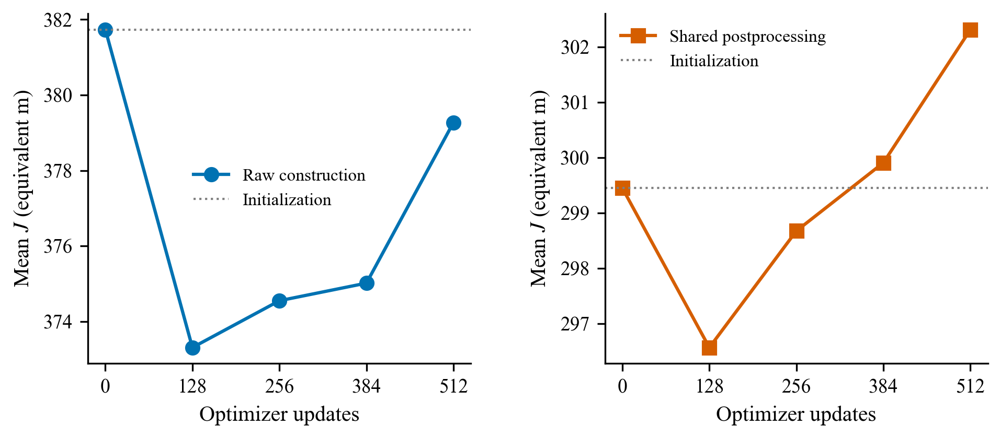
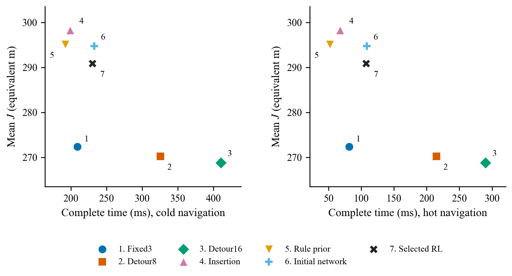

# 构造式研究 C0＋C1＋C2 结果

本轮为独立构造式路线的一次受控先导实验。原 v4／v5／v5.1、G2～G2.3 的源码、模型与结果保持冻结，Fixed3／Detour继续默认。没有重启旧局部窗口＋STOP训练，没有运行C3、独立测试或跨规模评估。

## 1. 实际完成的范围

- 小规模完整候选全局DP 12/12 求到最优，基线候选受限DP 12/12 求到最优；6/12 例满足完整问题UB严格低于受限问题LB。受限问题允许删站，不能称固定全部停靠点的TSP。
- 新环境关键合同检查最终7/7通过：覆盖与奖励、空任务与不可达、批量padding与ID映射、逐臂交集、后处理、真实梯度及屏蔽无穷距离的梯度安全。
- 24个百桌开发场景：C0为480次基线冷热测量；训练后再完成672次、7方法全交错测量。两批重用同一24场景，不能计为48个独立场景。
- 一种子完成512次Adam更新、16,384条C2采样完整轨迹，另有16,384条冻结贪心基线轨迹。24个训练地图种子复用，任务种子逐轨迹不同。
- 网络明确带有可学习的log[gain/(d+λ)]规则先验，初始权重4、注意力查询初始为0；初始质量来自该先验，不能算训练收益。初始网络与纯确定性先验均保留作对照。
- 全部16,384条训练采样路线已按种子重新生成输入并重放，共1,584,734个服务转移；完整几何检查覆盖列出的541份保存方案，另有3份训练重放样例证书。没有宣称全部采样轨迹都重新执行了几何或IK认证。

## 2. 精确参照

| 方法 | 12例平均最优差距 | 最大差距 |
| --- | ---: | ---: |
| Fixed3 | 1.3841% | 7.6014% |
| Detour8 | 0.4962% | 4.5994% |
| Detour16 | 0.4962% | 4.5994% |
| 覆盖感知插入 | 6.9583% | 20.4392% |

完整输入为4×3桌、96个原始候选和6／10／14任务各4例。保留原始导航图距离，未截取有效候选。最优性只针对给定离散候选和度量成本；不涉及连续工作空间或真实机械臂。六例集合外候选价值支持这个控制自由度值得检验，不能证明新网络已经学会利用它，也不能把Fixed3写成不能改变停靠集合。

## 3. 同一轮质量—时间比较

以下均为CPU单线程、预加载模型的开发集测量。完整请求时间包含输入准备、决策、后处理、路径展开与最终独立验证；模型加载单列，输入场景生成、输出序列化及另列的原始方案研究审计不计入部署时间。各方法两次重复按预登记顺序交错，冷热导航分别计时。按协议先在场景内平均两次测时，再报告24个场景平均时间的中位及p95；原始48次测量的p95另外列出。场景平均时间的p95不等于逐请求尾时延。

| 方法 | 平均J | raw平均J | 平均L | 平均K | 冷中位／p95 ms | 热中位／p95 ms | 回退比例 |
| --- | ---: | ---: | ---: | ---: | ---: | ---: | ---: |
| Fixed3 | 272.3430 | 272.3430 | 215.4680 | 75.83 | 209.04／310.87 | 81.68／167.69 | 0.0% |
| Detour8 | 270.2193 | 270.2193 | 213.1880 | 76.04 | 325.79／513.88 | 215.13／362.11 | 0.0% |
| Detour16 | 268.7966 | 268.7966 | 211.8591 | 75.92 | 410.51／633.39 | 290.09／496.59 | 0.0% |
| 覆盖感知插入 | 298.2598 | 313.9452 | 240.3848 | 77.17 | 199.11／280.59 | 67.68／134.08 | 0.0% |
| 确定性覆盖先验 | 295.0840 | 377.2286 | 238.1153 | 75.96 | 192.18／248.11 | 52.12／101.67 | 0.0% |
| 初始网络 | 294.7236 | 378.3182 | 237.8174 | 75.88 | 232.62／334.51 | 108.39／189.19 | 0.0% |
| 已选RL网络 | 290.8603 | 370.1982 | 233.8915 | 75.96 | 230.03／337.53 | 107.29／186.35 | 0.0% |

| 方法 | 冷导航48次原始测量p95 ms | 热导航48次原始测量p95 ms |
| --- | ---: | ---: |
| Fixed3 | 309.78 | 165.21 |
| Detour8 | 515.98 | 363.30 |
| Detour16 | 635.16 | 501.45 |
| 覆盖感知插入 | 281.16 | 135.40 |
| 确定性覆盖先验 | 248.84 | 102.44 |
| 初始网络 | 338.57 | 189.75 |
| 已选RL网络 | 338.03 | 187.21 |

插入、先验、初始网络及RL网络共用同一删冗余＋2-opt后处理。Fixed3／Detour保留其完整强实现，包括多配方构造、候选替换、内部后处理与保底。模型未在线额外运行Fixed3，也不具有逐例不劣于Fixed3的保证。所有672个raw／final有效性标记通过；原始构造另由保存的标量几何检查器核对。表中规则方法raw列是其完整返回方案，不代表去除其原有后处理的消融。

## 4. 登记门槛

| 条件 | 冷导航 | 热导航 |
| --- | ---: | ---: |
| 相对Detour16的J劣化单侧95%上界（≤0.5%） | 9.7604 | 9.7604 |
| 完整中位时间比（≤0.7） | 0.5604 | 0.3699 |
| p95时间比（≤1） | 0.5329 | 0.3753 |

冷导航主实用目标：未通过；热导航：未通过。平均质量劣化按独立场景相对差再平均，置信上界由24场景配对bootstrap得到。只有一个训练种子且权重经过选择，不能扩展为正式新测试或跨种子结论。
汇总质量与中位时间同时支配RL的参照：冷导航['fixed3']；热导航['fixed3']。这指两项汇总指标，不是每个实例的逐项时延证明。

模型比Fixed3的平均J高18.5173，其中路径长度差为18.4236，停靠惩罚差为0.0938。因此这组汇总差距主要体现在路程，不能仅凭该分解区分停靠点位置与排序各自的作用。模型raw到post的逐场景平均降本为21.31%，该部分来自统一后处理，不能归为纯RL收益。

## 5. 学习趋势与继续判断

| 更新 | 选择集raw平均J | 选择集post平均J |
| ---: | ---: | ---: |
| 0 | 381.7342 | 299.4501 |
| 128 | 373.3147 | 296.5643 |
| 256 | 374.5549 | 298.6736 |
| 384 | 375.0207 | 299.9073 |
| 512 | 379.2760 | 302.3157 |

按最低选择集post均值选择第128次检查点，保留了所有检查点而非只交付最佳点。相对初始网络的选择集均值下降为0.9637%，场景配对95%区间[0.2142%, 1.7288%]。这里按协议字段计算均值之比；逐场景相对改善的均值另为0.8578%，两种口径不混用。
登记的继续信号（均值下降≥1%、区间下界>0、冷中位时间≤Detour16的0.9倍且有效）未通过。本轮不自动启动C3，不追加同一配置训练；该判断并非构造式DRL普遍无效的证明。

选择集用于选择权重，开发集还用于rollout基线更新和诊断，均不能冒充独立测试。学习曲线后段不保证改进；采样训练成本降低也不等于后处理后的贪心部署质量同步改善。没有CSP适配、BC／一步或聚合特征消融，因此即使出现学习增量，也不能把关系编码或长期信用分配的独立作用写成已证明。

## 6. 资源与记账边界

训练用RTX 4070 Laptop GPU（8GB），实际优化阶段约13.30分钟，事前吞吐锁定的软上限为5885秒。主轨迹吞吐约20.52条/秒（含准备、周期验证等优化循环开销，进程导入不计）。最终第512次更新相对初始化的26/26个参数张量发生变化；这个计数不用于描述已选第128次权重。不能把无实用优势解释为没有训练。
- C2优化采样16,384条，贪心训练基线16,384条，周期CPU验证432条。
- 吞吐的64条贪心前反向探针之外，另有CPU／GPU各1条单场景延时探针；原summary字段仅涵盖前者。
- C1三次合同测试执行（两次6项、最终7项）额外包含7条随机采样、12条贪心输入轨迹；此项由工具执行记录与批大小后算。全部随机调用不能写成只有16,384条。
- 最终开发评价、CLI样例、保存路线重放与几何复验分别记录在resource_accounting.json。没有新的优化更新。
- 复验首轮完成全部路线重放及543份几何证书后，在CLI样例的默认GBK／UTF8读取处失败。保留原失败日志及复验源码；使用显式、事后标明来源的重放恢复收据，修正UTF8读取后重做544份几何／文件检查，没有重复16,384条数值重放。两次实际验证证书合计1087，不能当作独立场景数量。
- 原baseline日志的one_sided_p字段记录双侧p/2；只在候选均值确实降低时用于替换。resource_accounting.json另给真正的下降方向p，较差候选不能按小p宣称改善。替换行为和原结果没有变化。
- 协议与硬件在本地实验前保存，Git提交在任务收尾时生成；本轮不冒称公开平台事前注册。未保存重复800×800距离矩阵，完整导航缓存只在内存驻留。

## 7. 使用与当前定位

研究模型入口：`python -B -m rc3_constructive.plan --seed 7300000000 --mode regular --output outputs/constructive.json`。输出含完整折线路径、服务顺序、每项任务的候选及执行臂；默认使用本轮选择的检查点。该CLI是研究入口，不替换默认Fixed3／Detour。固定高度、独立顺序任务、静态二维地图和代理可达性边界不变。

下一步仅按独立审查意见列研究建议；没有运行三种子、60个保留测试场景、跨规模或新的算法调参。未来若继续，首先解释与强规则前沿的质量差距、初始化先验与后处理贡献，再决定是否值得扩大训练，而不能仅因训练成本下降就进入正式论文优越性主张。

证据入口：protocol.yaml；paper/EXPERIMENT_PLAN.md；outputs/small_exact.json；outputs/final_evaluation.json；outputs/training_summary.json；outputs/validation_curve.json；outputs/verification.json；outputs/resource_accounting.json；figures/。开源来源及实际未运行内容见OPEN_SOURCE_NOTES.md。

## 8. 独立审查与图表

独立审查判定主实用主张no、有限学习信号partial，图表QA通过，详见 [结果到主张判定](EXPERIMENT_RESULT_TO_CLAIM.md) 和 [图表检查](figures/REVIEW.md)。下游论文判断仍为provisional；本轮不触发C3。

