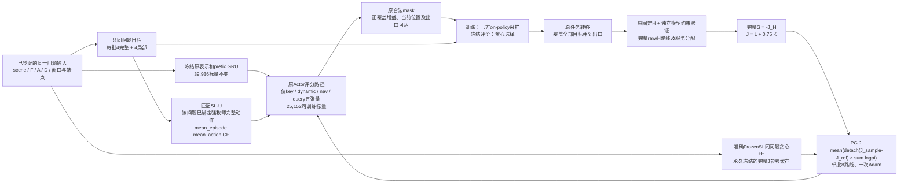

# 本候选的训练与冻结路径

两个训练流是独立的模型、Adam和采样状态，均从准确SL256重新克隆。图中共享评分框只表示相同结构与参数范围，不表示共享更新后的权重或轨迹。PG不读取教师动作作为提示。没有神经Critic、额外A1残差、PPO多epoch或永久贴近SL的guard。

Actor能改变合法停靠选择和访问顺序，进而影响覆盖路径及固定H结果；F/A、导航输入、mask、任务转移、成本、服务规则与H均保持原版。模型约束证书不是实际机械臂标定/IK或关节轨迹认证。

P1未通过，实际权重仅交付为科学证据；未替换项目默认方法，未进入部署优化或新父布局确认。
