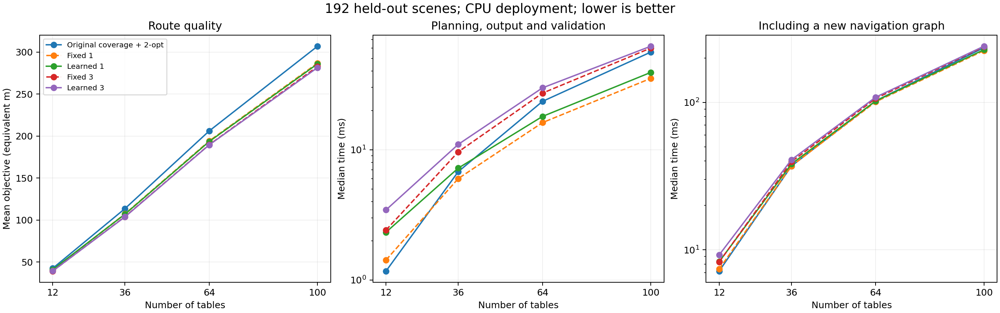
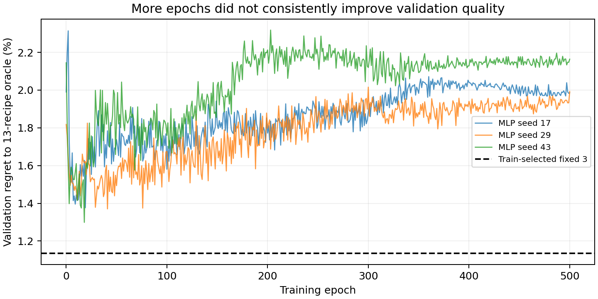
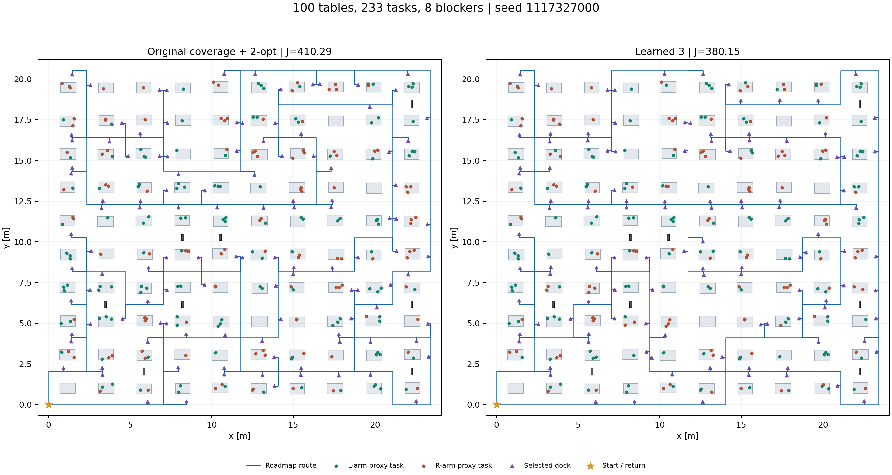

# 快速覆盖路由：实验结果与交付说明

本轮完成了可部署模型、共享求解器优化、扩大训练和独立留出测试。主要改善来自向量化和覆盖保持的停靠点优化；是否存在额外学习收益，需看同预算固定策略对照。

## 方法与数据

- 最终学习模型为 64 棵树的组合成本回归选择器，按验证集从两类 MLP 与随机森林中选出；一次预测后执行 1 或 3 个构造配置。不是端到端神经路径解码器。
- 训练/验证/测试为 1,152/192/192 个场景，含 12、36、64、100 张桌和三种复杂度。划分种子完全不重叠；最终测试不曾用于训练或选模型。
- 另有 24 个 144/196 桌外推场景，均在模型冻结前确定。外推样本较少，不用于证明一般跨尺寸能力。
- MLP 两种目标各运行 3 个种子×500 轮，每种目标 27,000 次参数更新；另有初试 7,500 次更新。按验证集保留较早检查点，不将训练轮数增加等同于质量提升。
- 路线目标 J=路程+0.75×停靠数。导航与可达性在所有方法间共用，不能把共同预处理优化误计为学习模型收益。

## 同分布留出测试

以下为 100 桌子集（48 个场景）的结果。规划耗时包含策略/特征、搜索、完整路径展开和独立校验；冷地图再包含导航预处理。均排除进程启动、模型加载和磁盘写入。

| 方法 | 平均 J / 等效米 | 规划中位数 / ms | 冷地图总时间 / ms | 缓存地图总时间 / ms |
|---|---:|---:|---:|---:|
| Original coverage + 2-opt | 306.88 | 56.09 | 235.20 | 68.79 |
| Original nearest + 2-opt | 360.06 | 75.97 | 242.19 | 87.69 |
| Vectorized control | 306.88 | 32.81 | 224.47 | 43.82 |
| Default + dock search | 288.92 | 35.26 | 225.51 | 46.64 |
| Fixed 1 | 286.75 | 35.25 | 224.78 | 47.38 |
| Learned 1 | 285.84 | 39.17 | 227.79 | 50.93 |
| Fixed 3 | 282.73 | 60.23 | 238.52 | 71.99 |
| Learned 3 | 281.41 | 62.21 | 240.58 | 74.26 |

相对原 coverage+2-opt 的成本下降，按每个实例配对后平均；95% 区间为场景级 bootstrap，不是仅按聚合均值计算。

| 场景 | 模式 | 平均成本下降 | 95% 区间 | 规划速度比中位数 | 冷地图速度比中位数 |
|---|---|---:|---|---:|---:|
| all | Learned 1 | 5.48% | [4.76%, 6.16%] | 1.03× | 1.01× |
| all | Learned 3 | 7.95% | [7.36%, 8.56%] | 0.71× | 0.92× |
| tables_100 | Learned 1 | 6.87% | [5.71%, 7.98%] | 1.49× | 1.10× |
| tables_100 | Learned 3 | 8.40% | [7.47%, 9.30%] | 0.96× | 0.99× |
| 100_complex | Learned 1 | 7.31% | [5.98%, 8.67%] | 1.50× | 1.10× |
| 100_complex | Learned 3 | 8.85% | [7.78%, 9.90%] | 0.99× | 1.00× |
| 100_blocked | Learned 1 | 6.71% | [4.67%, 8.72%] | 1.43× | 1.09× |
| 100_blocked | Learned 3 | 8.55% | [7.27%, 10.10%] | 0.99× | 1.00× |

## 学习的独立贡献

固定配置/组合均由训练集选出，与学习方法执行相同数量的候选、相同局部搜索。以下正值才代表学习选择优于固定策略。

| 场景 | 学习与固定对照 | 平均成本下降 | 95% 区间 | 胜/平/负 |
|---|---|---:|---|---|
| all | Learned 1 vs Fixed 1 | -0.113% | [-0.637%, 0.394%] | 46/98/48 |
| all | Learned 3 vs Fixed 3 | 0.157% | [-0.098%, 0.414%] | 49/108/35 |
| tables_100 | Learned 1 vs Fixed 1 | 0.267% | [-0.142%, 0.738%] | 8/35/5 |
| tables_100 | Learned 3 vs Fixed 3 | 0.419% | [-0.055%, 0.932%] | 16/23/9 |

选择器仍不能被解释为优于强无学习优化的证据。若上述区间跨过 0，独立学习收益不确定；若均值为负，则该测试中固定策略更好。部署时保留固定组合，是根据验证集作出的选择，不是测试后改选模型。

## 超出训练规模

| 桌子数 | 方法 | 平均 J | 规划中位数 / ms | 冷地图总时间 / ms |
|---|---|---:|---:|---:|
| tables_144 | Original coverage + 2-opt | 436.92 | 165.38 | 545.50 |
| tables_144 | Fixed 1 | 411.21 | 84.17 | 500.15 |
| tables_144 | Fixed 3 | 408.13 | 146.88 | 542.30 |
| tables_144 | Learned 1 | 411.04 | 91.79 | 505.56 |
| tables_144 | Learned 3 | 408.87 | 151.00 | 545.71 |
| tables_196 | Original coverage + 2-opt | 655.23 | 437.77 | 1232.76 |
| tables_196 | Fixed 1 | 617.33 | 187.17 | 977.14 |
| tables_196 | Fixed 3 | 608.14 | 315.49 | 1110.48 |
| tables_196 | Learned 1 | 614.26 | 196.23 | 987.05 |
| tables_196 | Learned 3 | 608.59 | 321.10 | 1116.09 |

两组测试共 1944 个不同“场景×方法”计划通过覆盖、用臂分配、停靠顺序、障碍碰撞、路径和成本一致性检查。每个方法重复计时 3 次；重复计时不增加独立样本数。

## 训练效率与计时限制

标签生成只做一次，随后训练读取缓存特征与成本；MLP 数据常驻 GPU。推理导出不依赖 PyTorch/scikit-learn，避免逐停靠调用模型。每个场景特征提取、搜索和独立校验仍有实际成本，不能只报告模型前向时间。

| 运行 | 训练时间 / s | 更新数或树模型配置数 |
|---|---:|---:|
| run_selector_20261102 | 15.81 | 7500 |
| run_extended_20261102 | 51.86 | 27000 |
| run_portfolio_20261102 | 98.24 | 27000 |
| run_forest_20261102 | 26.15 | 9 |

CPU：AMD Ryzen 7 7745HX；GPU 训练：RTX 4070 Laptop 8 GB。时延来自本机单次实验中的三次重复中位数，受系统负载影响；未包含实机执行。模型文件和输入地图常驻时适合复用缓存，首次建图耗时不可忽略。

## 证据边界和后续方向

- C1 部分支持：百桌 top-1 相对原覆盖基线的平均成本下降 6.87%，配对规划速度比中位数 1.49×；首次建图后的速度比仅 1.10×。小规模场景和三策略模式并不普遍更快。
- C2 未证实：相对同预算固定策略的成本差异置信区间包含 0。下一步需要更有空间结构的信息或直接学习局部改进，继续增加相同数据上的轮数不足以解决问题。
- 仍是二维导航与代理可达性。固定升降、独立单臂任务；没有真实 IK、双臂同步协调、机械臂避障、动力学或在线任务到达。
- 导航只保证指定通道图上的最短路；局部搜索不保证全局最优。复杂障碍分布是结构化生成，不代表任意拥堵环境。

## 文件

- `deployment/selector.npz`：验证集选出的最终可部署模型；`selector_neural.npz` 保留神经网络版本。
- `deployment/selection.json`：测试前冻结的模型选择记录和哈希。
- `benchmark_20261102/metrics.csv`、`summary.json`、`plans/`：192 个留出场景的原始结果。
- `benchmark_ood_20261102/`：144/196 桌外推结果。
- `data_extended_20261102/split_audit.json`：划分审计；`run_*/history.csv`：神经训练曲线。
- 运行命令与 API 见 `README.md`。

路径图使用按文件名排序的第一个百桌 blocked 测试场景：`scene_plan_10x10_blocked_1117327000.json`，没有按收益挑选。
