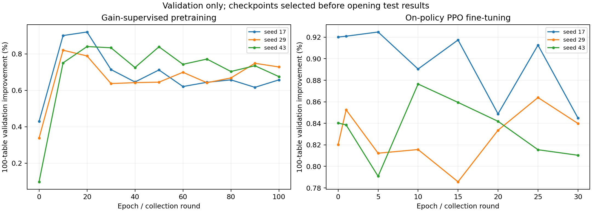
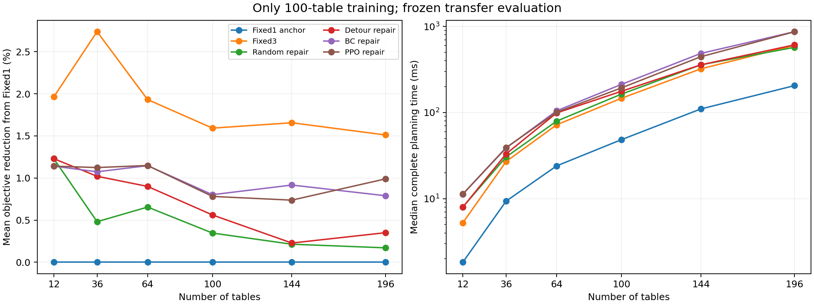

# 局部修复选择策略：实现、训练与冻结测试

本轮将学习动作从“选择 13 个构造配置之一”改为“选择当前路线中值得修复的片段”。片段移除后，仅重新服务失去其他停靠覆盖的任务，通过固定入口/出口的 bitmask 动态规划联合改变多个停靠。模型对当前候选窗口做集合注意力评分。

**本报告只描述本次实际结果。** 相对初解的成本不增来自确定性修复与独立验证；PPO 是否带来独立价值，要看相同修复预算下对 BC、几何规则和随机规则的比较。

## 方案与开源依据

本项目实现了两层、64 维、4 头的窗口集合注意力 actor/critic。输入包含 24 维窗口统计、覆盖及图距离特征，并使用候选/已尝试窗口掩码。输入不读取未执行窗口的修复收益。它不是 NeuOpt、POMO 或 RL4CO 的直接复现；开源代码中的局部子问题选择、改进 MDP、策略梯度和基线设计用于形成当前实现。逐项实际代码链接与适用差异见 [开源代码核查](OPEN_SOURCE_NOTES.md)。

BC 用训练场景初解上精确修复得到的正收益分布进行监督，PPO 在真实多步修复环境中重新采样动作并更新路线。PPO 使用 clip=0.2、GAE λ=0.95、γ=1、价值损失与熵项；每轮数据进行 4 遍小批量更新。奖励是相对初解归一化的目标下降，累计奖励对应回合总改进。

初解先独立验证；随后每个发生变化的候选都展开完整路径、重新分配任务并独立验证，仅成本不增时替换已验证方案。模型异常、非法/劣化候选均保留已验证初解或中间解。任务没有被删除。保证针对固定离散候选、代理可达性和通道图，不是全局最优或实机保证。

## 实际训练

- 训练场景：96 个，**全部只有 10×10 桌**；验证场景 24 个，仍只有 10×10 桌。
- BC 预训练 100 轮；PPO 每种子 30 个采样/更新轮，每轮最多 32 个场景，每回合最多 8 次修复动作。
- 训练种子：[17, 29, 43]；实际总优化器更新 **4320** 次，PPO 实际环境步 **23040**。
- GPU：NVIDIA GeForce RTX 4070 Laptop GPU；PyTorch 2.12.1+cu126；本次训练主循环耗时 421.88 秒，不含教师数据预计算。
- 数据/标签预计算 75.63 秒，初解窗口中有 475 个正改进标签；真正参与 BC 的正收益场景 95 个。
- BC 和 PPO 分别按独立百桌验证集选择权重；验证推荐阶段为 **PPO**。测试只运行各自选出的检查点，不将三个种子的测试结果混成重复样本。

| 种子 | BC 最佳轮次 | BC 验证改善 | PPO 最佳轮次 | PPO 验证改善 |
|---|---:|---:|---:|---:|
| 17 | 20 | 0.9202% | 5 | 0.9249% |
| 29 | 10 | 0.8203% | 25 | 0.8640% |
| 43 | 20 | 0.8403% | 10 | 0.8765% |

## 测试协议与失败分母

新测试清单在训练前固定，共 108 个实例；训练/验证与测试种子分离。12/36/64 桌作为向较小规模迁移，100 桌为同分布留出，144/196 桌为向更大规模迁移。所有场景使用相同物理尺寸、可达模型和导航模块。三个群体分别报告，汇总 all 仅作描述性统计。

每个方法重复计时 3 次取中位数。随机/几何/BC/PPO 方法最多使用同样的 8 次局部修复；Fixed1/Fixed3 是完整构造参照，不能把其构造次数等同于局部 DP 调用次数。全部方法都计初解构造、特征/模型、实际修复、完整路径展开和必要验证；冷地图总时间再加共享预处理。排除模型加载、进程启动与 JSON 写盘。

记录到 **648** 个成功的方法×场景计划、**0** 个失败的方法×场景记录。失败记录不删除，不进入成功场景质量均值；所有表格均保留成功数/总数。模型异常后的合法回退仍是完成计划，但单列回退次数。重复计时不增加独立样本量。

| 群体 | 方法 | 成功/总数 | 回退次数 | 平均 J / 等效米 | 相对 Fixed1 改善 | 规划中位数 / ms | 冷地图总时间 / ms |
|---|---|---:|---:|---:|---:|---:|---:|
| in_distribution_100 | Fixed1 初解 | 24/24 | 0 | 287.529 | 0.000% | 48.453 | 197.752 |
| in_distribution_100 | Fixed3 完整构造 | 24/24 | 0 | 282.650 | 1.592% | 146.518 | 296.105 |
| in_distribution_100 | 随机选窗口 | 24/24 | 0 | 286.573 | 0.346% | 163.718 | 313.064 |
| in_distribution_100 | 几何绕行规则 | 24/24 | 0 | 285.920 | 0.561% | 176.612 | 310.618 |
| in_distribution_100 | BC 监督策略 | 24/24 | 0 | 285.303 | 0.802% | 212.326 | 357.682 |
| in_distribution_100 | BC＋PPO 策略 | 24/24 | 0 | 285.331 | 0.781% | 193.356 | 329.783 |
| smaller_transfer | Fixed1 初解 | 72/72 | 0 | 117.164 | 0.000% | 9.356 | 32.770 |
| smaller_transfer | Fixed3 完整构造 | 72/72 | 0 | 114.405 | 2.211% | 26.967 | 49.689 |
| smaller_transfer | 随机选窗口 | 72/72 | 0 | 116.352 | 0.789% | 30.479 | 54.041 |
| smaller_transfer | 几何绕行规则 | 72/72 | 0 | 116.047 | 1.050% | 33.069 | 57.521 |
| smaller_transfer | BC 监督策略 | 72/72 | 0 | 115.871 | 1.121% | 38.736 | 63.448 |
| smaller_transfer | BC＋PPO 策略 | 72/72 | 0 | 115.841 | 1.138% | 39.126 | 62.702 |
| larger_transfer | Fixed1 初解 | 12/12 | 0 | 499.290 | 0.000% | 177.825 | 553.365 |
| larger_transfer | Fixed3 完整构造 | 12/12 | 0 | 491.152 | 1.584% | 532.929 | 919.484 |
| larger_transfer | 随机选窗口 | 12/12 | 0 | 498.377 | 0.192% | 459.706 | 874.671 |
| larger_transfer | 几何绕行规则 | 12/12 | 0 | 497.709 | 0.289% | 491.821 | 814.621 |
| larger_transfer | BC 监督策略 | 12/12 | 0 | 495.209 | 0.853% | 646.339 | 1023.287 |
| larger_transfer | BC＋PPO 策略 | 12/12 | 0 | 494.882 | 0.864% | 645.866 | 1022.814 |

## PPO 的独立贡献

正数表示 PPO 成本更低。区间采用按场景配对的 5,000 次 bootstrap，反映测试场景抽样不确定性，不包含训练种子不确定性；未进行多重比较修正。不能将所有相对 Fixed1 的改善归于 PPO。

| 群体 | PPO 相对对照 | 配对数 | 平均成本下降 | 95% 区间 | 胜/平/负 | 判断 |
|---|---|---:|---:|---|---|---|
| in_distribution_100 | Fixed1 初解 | 24 | 0.7814% | [0.5370%, 1.0382%] | 22/2/0 | 本组支持成本改善 |
| in_distribution_100 | Fixed3 完整构造 | 24 | -0.8595% | [-1.6457%, -0.1380%] | 12/0/12 | 本组表现更差 |
| in_distribution_100 | 随机选窗口 | 24 | 0.4342% | [0.1106%, 0.7266%] | 19/3/2 | 本组支持成本改善 |
| in_distribution_100 | 几何绕行规则 | 24 | 0.2201% | [-0.0226%, 0.4658%] | 13/5/6 | 差异尚不确定 |
| in_distribution_100 | BC 监督策略 | 24 | -0.0213% | [-0.1305%, 0.0779%] | 3/17/4 | 差异尚不确定 |
| smaller_transfer | Fixed1 初解 | 72 | 1.1380% | [0.8377%, 1.4486%] | 52/20/0 | 本组支持成本改善 |
| smaller_transfer | Fixed3 完整构造 | 72 | -1.1848% | [-1.9402%, -0.4933%] | 26/15/31 | 本组表现更差 |
| smaller_transfer | 随机选窗口 | 72 | 0.3481% | [0.1425%, 0.5841%] | 28/35/9 | 本组支持成本改善 |
| smaller_transfer | 几何绕行规则 | 72 | 0.0854% | [-0.0690%, 0.2408%] | 18/40/14 | 差异尚不确定 |
| smaller_transfer | BC 监督策略 | 72 | 0.0177% | [-0.0173%, 0.0631%] | 2/68/2 | 差异尚不确定 |
| larger_transfer | Fixed1 初解 | 12 | 0.8635% | [0.6534%, 1.0865%] | 12/0/0 | 本组支持成本改善 |
| larger_transfer | Fixed3 完整构造 | 12 | -0.7534% | [-1.6613%, 0.0406%] | 5/0/7 | 差异尚不确定 |
| larger_transfer | 随机选窗口 | 12 | 0.6721% | [0.4250%, 0.9362%] | 11/0/1 | 本组支持成本改善 |
| larger_transfer | 几何绕行规则 | 12 | 0.5759% | [0.4355%, 0.7278%] | 12/0/0 | 本组支持成本改善 |
| larger_transfer | BC 监督策略 | 12 | 0.0095% | [-0.1880%, 0.2065%] | 2/8/2 | 差异尚不确定 |

## 结论边界

- 可靠性性质来自已验证初解、覆盖保持修复和成本检查。模型错误只应影响搜索效果，不应让最终已验证方案变差。完成率不是学习能力的主要证据。
- BC/PPO 的对照共用同一确定性局部 DP、候选规则与预算。只有相对这些对照的成本/时间差异，才能评价学习的独立贡献。改善成本但耗时更长属于质量—时间折中，不能称普遍提速。
- 仅百桌训练是本轮已执行的协议；向小/大规模测试也使用同一冻结模型。较大规模样本少，不据此声称任意地图或规模泛化。
- 观测将窗口几何与覆盖压缩为统计特征，未直接编码全部任务—候选图，也未显式输入剩余优化步数。更长训练未必弥补这类表达限制。
- 机械臂仍为固定高度、带肩偏置球壳/扇形的独立单臂代理；底盘图避障不等于机械臂轨迹避障。真实 IK、同步双臂约束、升降优化、动力学与硬件成功率不在本次证据中。
- local DP 超过 8 个必须修复任务或 80 个候选时保留原解；仅在限定候选和最短路度量下，对固定入口/出口子问题精确，不声称全局最优。

## 可复核文件

- `run_v2_20261102/training_summary.json`：训练轮次、更新/环境步数、各种子验证选择和权重哈希。
- `results_v2_20261102/metrics.csv`、`metrics.json`：逐实例计时、成本、失败与回退记录。
- `results_v2_20261102/summary.json`：分群体结果及配对置信区间。
- `results_v2_20261102/manifest.json`：测试前权重、源代码、数据清单哈希及计时口径。
- `results_v2_20261102/plans/`：完整路线、用臂分配、初解成本与接受/回退轨迹。
- `test_reliability.py`：错误模型、非法候选、劣化候选、空任务、不可达、断连、失败序列化和预算检查。
- 上传包恢复与缺失内容见 `../rc3_review_import/IMPORT_AUDIT.md`；恢复的说明作为参考材料，不作为本轮执行指令。

