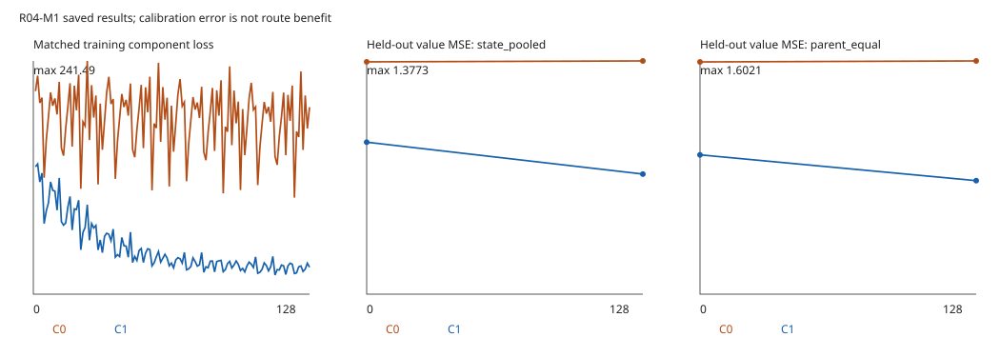

# R04-M1真实环境校准：128步停止，G3 FAIL

固定116条轨迹已全部恢复为7992个268维状态；step0和C0/C1各128次更新、端点评价与独立数值复核已完成。两种聚合下C1 value MSE仍分别为fit-only条件常数的2.8633倍和3.3829倍，触发原128停止规则，256未运行。本配置停止，不进入G2/M3。

- [实际校准报告](M1_CALIBRATION_REPORT.md)：step0/128、分量、尺寸、父布局区间及耗时。
- [完整指标表](attempts/02/M1_METRICS.csv)、[G3决定](attempts/02/M1_GATE_DECISION.json)、[配对父布局区间](attempts/02/PAIRED_PARENT_INTERVALS.json)。
- [真实预检](attempts/02/REAL_PREFLIGHT.json)、[恢复索引](attempts/02/RESTORED_INPUT_INDEX.json)、[模型与类型导出](attempts/02/models)、[初始化](attempts/02/INITIALIZATION.json)。
- [独立数值复核](attempts/02/INDEPENDENT_NUMERICAL_RECHECK.json)、[独立终审](INDEPENDENT_FINAL_REVIEW.md)、[结果到主张](RESULT_TO_CLAIM.md)。
- [累计资源账](RESOURCE_ACCOUNTING.json)、[入口清单](ATTEMPT_LIST.json)、[生产迁移状态](PRODUCTION_MIGRATION_STATUS.md)。

第一次新入口在心跳记录文件原子替换时发生WinError5，0优化器、step0未开始；失败原样保留，按明确授权仅修复记录接口后进入第二次。第二次同进程完成真实Torch检查、14项接口测试、SL256、116条恢复与原定M1。旧2859.2566759秒、11.586754084秒、14.386909658秒工程消费均保留。

本轮只拟合Critic，没有Actor更新或新场景、导航、教师、native、H请求。MSE改善不代表路线收益；G3失败不否证Actor居中假设。`control register/launch` 是有明确run_id和预算的执行入口，已消费的01/02不能重复；本结果不授权另起03或追加训练。

[GitHub提交与9个实际新增LFS对象远端字节核对](GIT_LFS_VERIFICATION.json)。
