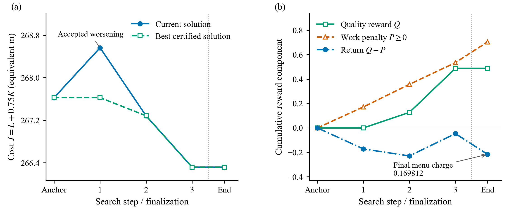

# G0 固定机制案例：case_01

本页从保存的 JSON 生成；制图前已运行 `runtime_rl.replay_file`。该案例是开发集有限深度 oracle 的机制展示，未训练或调用 PPO。

## 选择规则与证据范围

按 case 编号递增选择第一个 `worse_first_beats_one_step=true` 的场景：case_00 为 false，case_01 为 true。没有按降本幅度挑选最优案例。本例 seed=1854398144，10×10 张桌、177 个任务、800 个候选配置，保存动作索引为 `[1, 2, 2]`。

这里的“严格见证”仅表示：所选序列第一步被接受且 current 变差，其深度 3 终值 266.318221665 小于已查询根菜单的一步最好值 266.345313165，差 0.027091500。它不表示必须先变差：本例 `best_monotone_first_depth3_cost` 同为 266.318221665，`worse_first_beats_all_monotone_first=false`；该字段只限制第一步，并非完整单调搜索树证明。

## 图与图注

**图注：** 固定 G0 开发案例 case_01（深度 3、每层最多 8 个分支，含 STOP）的保存序列。左图为当前路线与最好已认证路线的加权成本；右图为累计质量奖励 Q、非负计算工作惩罚 P 和总回报 Q−P。Anchor 是认证 Fixed3 初解。End 是诊断深度结束后的最终验证与待结算菜单费用，不是第四次修复；虚线区分这两类阶段。目标 J=L+0.75K 是等效路程成本，不能解释为机器人任务执行时间。该图证明此查询范围内存在先变差后改善的有效序列，不证明变差的必要性、PPO 优势或部署速度。

图输出：`outputs/mechanism/case01_mechanism.pdf`、同名 SVG 与 300 dpi PNG。曲线数据、完整精度表格和来源哈希分别在 `mechanism_data.json`、`trajectory.csv`、`source_manifest.json`。

## 成本与累计回报

| 阶段 | current J | best / 返回 J | 累计 Q | 累计 P | 累计 Q−P | 累计工作单元 |
|---|---:|---:|---:|---:|---:|---:|
| anchor | 267.625042034 | 267.625042034 | 0.000000000 | 0.000000000 | 0.000000000 | 0 |
| step_1 | 268.563972632 | 267.625042034 | 0.000000000 | 0.172230000 | -0.172230000 | 172,230 |
| step_2 | 267.284243762 | 267.284243762 | 0.127341698 | 0.356971000 | -0.229629302 | 356,971 |
| step_3 | 266.318221665 | 266.318221665 | 0.488302724 | 0.534921000 | -0.046618276 | 534,921 |
| finalize | 266.318221665 | 266.318221665 | 0.488302724 | 0.704733000 | -0.216430276 | 704,733 |

采用原记录中的 epsilon=0.02、lambda_work=0.01、work_scale=10000、potential_weight=0。Q=100(J_anchor−J_best)/J_anchor；P=lambda_work×累计工作/work_scale。总质量改善为 0.488302724%，但总回报为 -0.216430276。同一根状态直接 STOP 的回报为 -0.171414000，因此该路径没有优于 STOP 的含工作惩罚回报；不能把质量见证写成已解决奖励权衡。

第三次动作结束后 Q−P=-0.046618276。随后单独结算已经构建的菜单：169,812 工作单元，P 增加 0.169812000，最终回报降至 -0.216430276。本次终验成功，没有质量回退校正。表内累计工作仅是所选序列的记账，不是发现它所花的整棵 oracle 搜索成本。

## 动作语义与服务点变化

下列 node 为导航节点编号（depot=0，候选 id=node−1），route 切片采用 Python 半开索引，且 route[0] 是起点。节点集合差用于描述服务点增删；完整访问顺序保存在 JSON，不能仅由集合差恢复。

| 步骤 | 动作 / route 切片 | 移除 node | 新增 node | 移除候选 id | 新增候选 id |
|---|---|---|---|---|---|
| 1 | replace / [7:8] | [107] | [108] | [106] | [107] |
| 2 | improve / [29:33] | [71, 73, 158] | [67, 80, 153] | [70, 72, 157] | [66, 79, 152] |
| 3 | improve / [4:8] | [95, 108] | [90, 105] | [94, 107] | [89, 104] |

第一步 replace 在本次候选池禁用 node 107，新增 node [108]；不修改 F/A。current 上升而 best 保持 anchor。第二、三步 improve 使用相同覆盖修复接口，在完整保留路线决定的必要任务上求解；第三步又移除了 node [108]。这些动作是在虚拟规划搜索中发生，机器人不会执行中间较差路线。所有被接受的路线均经完整认证。

## 原始 JSON 指针

以下指针均相对于 `outputs/g0/case_01/selected_replay.json`，完整机器可读映射在 `mechanism_data.json`。

| 数据 | JSON 指针 |
|---|---|
| 初解成本与路线 | `/state/anchor_cost`；`/state/anchor` |
| 第 i 次动作（i=0,1,2） | `/state/transitions/i/action`；`/state/transitions/i/action_id` |
| 动作前后完整 current 路线 | `/state/transitions/i/observation/current`；`/state/transitions/i/next_observation/current` |
| 动作后的 current / best 成本 | `/state/transitions/i/info/current_cost`；`/state/transitions/i/info/best_cost` |
| 单步质量、工作惩罚与回报 | `/state/transitions/i/info/quality_reward`；`/state/transitions/i/info/work_penalty`；`/state/transitions/i/reward` |
| 必要任务 | `/state/transitions/i/info/proposal/diagnostics/required_tasks` |
| 终止待结算菜单费 | `/state/events/0/menu_work_units`；`/state/events/0/work_penalty`；`/state/events/0/reward` |
| 最终回报与完整方案 | `/state/total_reward`；`/state/returned_certificate`；`/plan` |
| 严格见证的比较口径 | `case_01/summary.json` 中 `/root_one_step_best`、`/best_monotone_first_depth3_cost`、`/selected_is_strict_witness` |

复现命令：`python -B -m rc3_rl_research.tools.plot_mechanism`。脚本再次重放原记录、核对奖励望远镜恒等式、终止费用和输入 SHA-256 后生成输出。它只重放已有序列，既不重新搜索整个树，也不训练或测量模型性能。

## 来源文件哈希

- `outputs/g0/protocol.json`：`5e1f1e919c4ba6b7914b12b11d26279798beec4537680ba9f9918a6504c3bb8c`
- `outputs/g0/case_00/summary.json`：`e7f93af747e7e7d54fd7080e1a5bcc2dc8ff18012adbf4781776e32a384a14e8`
- `outputs/g0/case_01/summary.json`：`a93268bda8635ede6edeb2242c8b911b8513f4f4d0ea48515ffabef0034d31c8`
- `outputs/g0/case_01/selected_replay.json`：`5814ee5df494b10e09475566d0c3d969abe2971f89cbb137af27d195d8e28302`
