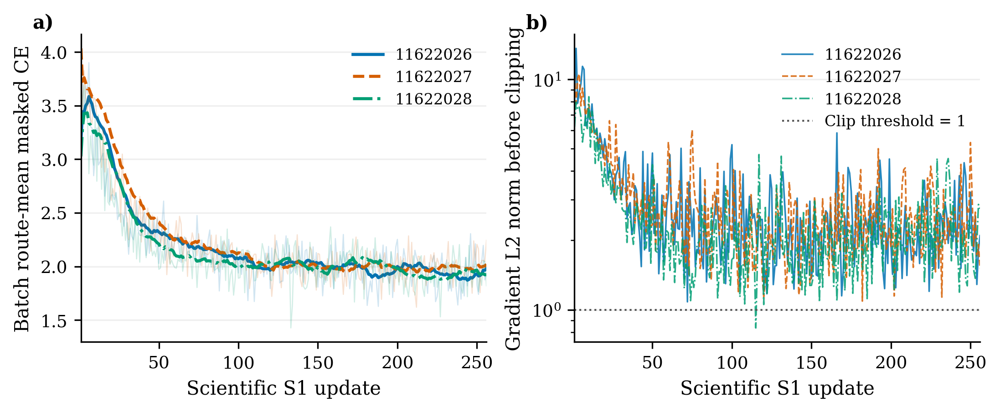
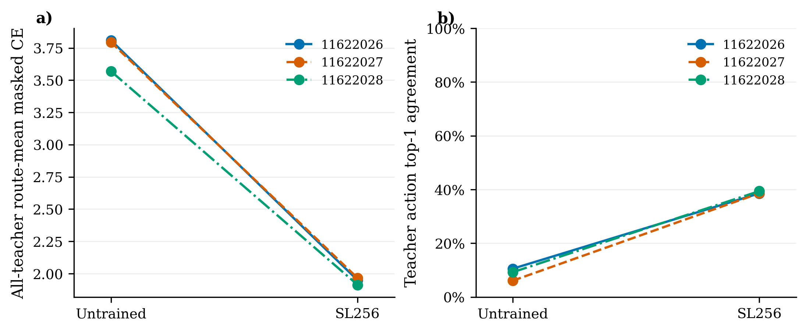

# S1-B 三种子监督初始化：实际执行结果

**三种子全部完成，各256次真实更新，共768次。S2技术准入GO；S2/S3未授权、未执行。**

| Seed | 更新 | 全教师初始CE | SL256 CE | 初始Top1 | SL256 Top1 | 训练阶段秒 |
|---|---:|---:|---:|---:|---:|---:|
| 11622026 | 256 | 3.808700 | 1.948343 | 10.55% | 38.56% | 369.565 |
| 11622027 | 256 | 3.794200 | 1.965552 | 6.09% | 38.60% | 385.016 |
| 11622028 | 256 | 3.568781 | 1.913012 | 9.25% | 39.40% | 363.173 |

CE为固定256条训练教师的路线宏平均；Top1为全部保存前缀的决策微平均。每个端点覆盖8292个状态，模型按教师动作推进。各seed多合法动作状态的命中率及Top3/5详见[诊断结果](TEACHER_STATE_DIAGNOSTICS.json)。这些数据反映训练教师状态上的部分模仿能力，不证明完整路线质量、未见场景泛化或DRL增量。

全部权重及Adam/RNG在[原实验目录](../rc3_global_local_execution_v3/runs/rc3_v3_global_local_20261106_01/)，每seed有untrained及32/64/96/128/160/192/224/256检查点。固定端点及哈希见[权重谱系](WEIGHT_LINEAGE.json)。

- [实验报告](EXPERIMENT_REPORT.md)、[技术复核](IMPLEMENTATION_REVIEW.md)、[机械审计](MECHANICAL_AUDIT.json)
- [独立审查](INDEPENDENT_REVIEW.md)、[结论边界](RESULT_TO_CLAIM.md)、[下一步决定](NEXT_STEP_DECISION.md)
- [资源账](RESOURCE_ACCOUNTING.json)、[Git版本核对](GIT_VERSION_AUDIT.json)、[发布收据](PUBLICATION_RECEIPT.json)
- [逐状态指标CSV](teacher_state_metrics.csv)、[三种子汇总CSV](seed_summary.csv)、[曲线数据和脚本](figures/)

新增教师、场景生成、导航求解、native、H均为0；原S1-A 1482份文件字节保持一致。S3及原60保留测试未读取/评价。
