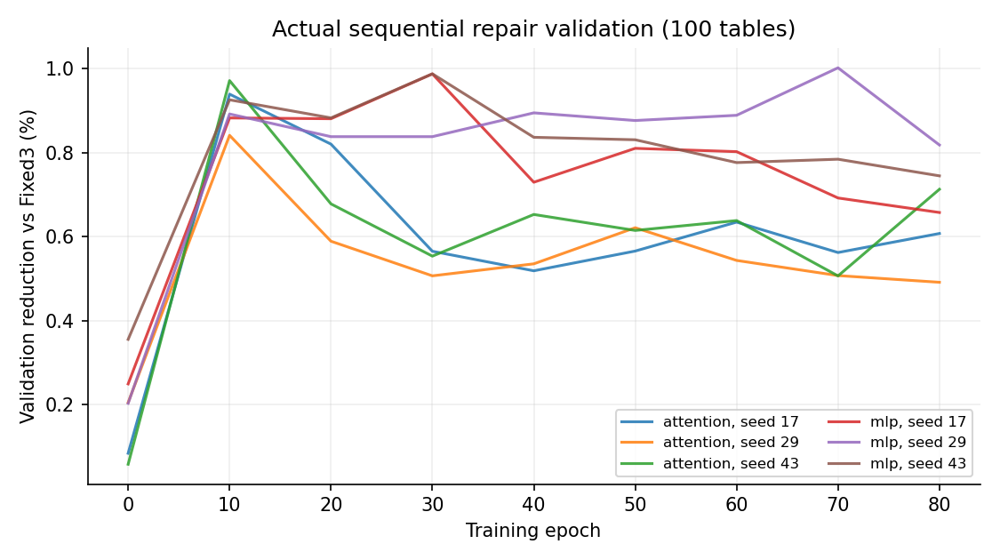
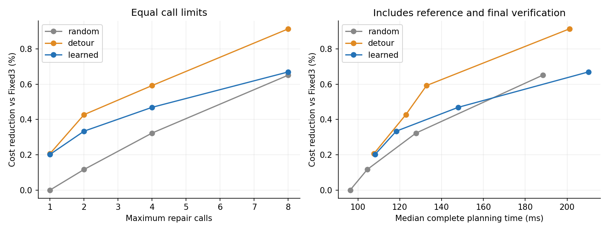

# v3 实际训练与冻结测试报告

**本次证据支持“经过验证的局部修复可降低初解成本”，尚不支持“学习选择器全面优于规则基线”。默认规划器继续保留 Fixed3。** 在54个主测试场景、最多8次DP修复预算下，学习模式相对Fixed3的联合目标平均下降0.786%，完整规划中位时间从52.80 ms增至177.39 ms；相对相同修复器的detour规则，平均下降仅0.060%，配对95%区间为[-0.110%, 0.241%]，跨零。

在100桌的9个分布内测试场景、8次预算下，学习与detour相对Fixed3分别降本0.670%和0.914%，规划中位时间分别为210.19 ms和201.15 ms。学习相对detour的成本下降为-0.249%，区间[-0.790%, 0.330%]，不能据此声称学习更优。

墙钟实验也仅使用这9个100桌场景。400 ms软上限下，学习相对detour的成本下降为-0.322%，区间[-0.647%, -0.017%]；800 ms时为-0.265%，区间[-0.540%, 0.000%]。这组结果不支持学习选择的优势。墙钟区间统一引用`in_distribution_100`组；原始汇总中的重复分组不构成额外样本。

以上三段为冻结测试后的结论审查补充，后续脚本生成表格未改。完整证据边界与数字复核见`claims_review.md`；这些结论不用于继续调整本轮模型。

本轮从较强的 Fixed3 已验证初解出发，学习选择局部覆盖修复片段。模型训练采用多状态收益监督，**不是新增 PPO 训练**。

首轮6次训练仅用于验证诊断，发现STOP与窗口共用softmax会过早停止，保留在run_v3_20261102。正式轮将STOP改为独立全局二分类，固定保守阈值0.9；以下主结果来自重新训练的正式轮。两轮共23,040次参数更新；没有因测试结果重新调参。

训练：96个100桌场景，18个独立100桌验证场景；384个真实中间状态，其中35个全零收益状态。两个架构各3种子，每个至80轮，共11520次优化器更新，用时211.4秒。

选中：mlp，seed 29，第70轮，验证相对Fixed3平均降本1.0016%，14,596个参数。选择依据是验证集真实连续修复结果；测试没有参与选模。

数据生成用时246.3秒，教师真实求解调用29,212次；训练状态覆盖0至7步。数据缓存16.87 MiB，未重复存储大导航矩阵。

冻结测试60场景，方法×预算结果861条，成功861条、失败0条；所有重复的最终方案共2583份保存供独立复验。

## 次数预算结果

表中降本为逐场景相对Fixed3百分比的均值。完整规划包含初解、特征、模型、修复及最终验证；冷总时间还包含共享导航与可达性预处理。

| 组别 | 方法/预算 | 场景数 | 降本% | 规划中位ms | 冷总中位ms | 实际调用均值 |
|---|---|---:|---:|---:|---:|---:|
| in_distribution_100 | fixed3 | 9/9 | 0.000 | 68.52 | 248.69 | 0.00 |
| in_distribution_100 | random_calls_8 | 9/9 | 0.652 | 188.38 | 356.25 | 8.00 |
| in_distribution_100 | detour_calls_8 | 9/9 | 0.914 | 201.15 | 353.50 | 8.00 |
| in_distribution_100 | learned_calls_8 | 9/9 | 0.670 | 210.19 | 377.93 | 8.00 |
| smaller_transfer | fixed3 | 27/27 | 0.000 | 10.39 | 39.66 | 0.00 |
| smaller_transfer | random_calls_8 | 27/27 | 0.783 | 41.34 | 69.71 | 7.96 |
| smaller_transfer | detour_calls_8 | 27/27 | 0.794 | 43.74 | 73.98 | 7.96 |
| smaller_transfer | learned_calls_8 | 27/27 | 0.850 | 65.32 | 89.13 | 6.11 |
| larger_transfer | fixed3 | 18/18 | 0.000 | 175.14 | 715.73 | 0.00 |
| larger_transfer | random_calls_8 | 18/18 | 0.419 | 477.52 | 1006.41 | 8.00 |
| larger_transfer | detour_calls_8 | 18/18 | 0.533 | 463.96 | 1021.38 | 8.00 |
| larger_transfer | learned_calls_8 | 18/18 | 0.750 | 505.73 | 1060.81 | 8.00 |
| stress_over_196 | fixed3 | 6/6 | 0.000 | 786.09 | 2971.59 | 0.00 |
| stress_over_196 | random_calls_8 | 6/6 | 0.066 | 1415.41 | 3600.91 | 8.00 |
| stress_over_196 | detour_calls_8 | 6/6 | 0.237 | 1660.31 | 3845.81 | 8.00 |
| stress_over_196 | learned_calls_8 | 6/6 | 0.246 | 1697.94 | 3883.44 | 8.00 |

## 学习选择的独立贡献

下表正数代表学习成本更低。区间是5000次场景配对bootstrap的95%区间，不包含训练种子不确定性，也未作多重比较校正。

| 组别 | 学习预算 | 参照 | 配对数 | 降本% | 95%区间 |
|---|---|---|---:|---:|---|
| in_distribution_100 | 8 | fixed3 | 9 | 0.670 | [0.353, 1.147] |
| in_distribution_100 | 8 | detour_calls_8 | 9 | -0.249 | [-0.790, 0.330] |
| in_distribution_100 | 8 | random_calls_8 | 9 | 0.016 | [-0.501, 0.385] |
| smaller_transfer | 8 | fixed3 | 27 | 0.850 | [0.371, 1.519] |
| smaller_transfer | 8 | detour_calls_8 | 27 | 0.059 | [-0.133, 0.296] |
| smaller_transfer | 8 | random_calls_8 | 27 | 0.066 | [-0.137, 0.249] |
| larger_transfer | 8 | fixed3 | 18 | 0.750 | [0.463, 1.047] |
| larger_transfer | 8 | detour_calls_8 | 18 | 0.216 | [-0.062, 0.523] |
| larger_transfer | 8 | random_calls_8 | 18 | 0.332 | [0.182, 0.500] |
| stress_over_196 | 8 | fixed3 | 6 | 0.246 | [0.090, 0.434] |
| stress_over_196 | 8 | detour_calls_8 | 6 | 0.008 | [-0.364, 0.350] |
| stress_over_196 | 8 | random_calls_8 | 6 | 0.181 | [-0.001, 0.405] |

## 软完整时间预算

只对100桌9个冻结场景评估，时间档从验证集确定。安全调用上限256，超过训练的8步范围。新修复启动前检查时钟，但正在执行的DP和必要最终验证可能超时；因此这是相同软时间上限的实测对照，**不是严格等时或硬实时保证**。每场景重复3次，成本先取重复均值，耗时取中位数；不挑最好一次。

| 方法/时间档 | 降本% | 规划中位ms | 调用均值 | 超时比例% |
|---|---:|---:|---:|---:|
| random_wall_200ms | 1.116 | 226.83 | 12.41 | 100.0 |
| detour_wall_200ms | 1.145 | 229.49 | 12.15 | 100.0 |
| learned_wall_200ms | 0.857 | 228.92 | 9.33 | 100.0 |
| random_wall_400ms | 1.851 | 428.68 | 37.19 | 100.0 |
| detour_wall_400ms | 1.896 | 428.87 | 36.70 | 100.0 |
| learned_wall_400ms | 1.583 | 428.02 | 26.26 | 100.0 |
| random_wall_800ms | 2.115 | 825.21 | 72.59 | 55.6 |
| detour_wall_800ms | 2.361 | 822.97 | 72.04 | 55.6 |
| learned_wall_800ms | 2.105 | 824.09 | 61.52 | 77.8 |

## 工程提速诊断（18个验证场景）

冻结测试完成后，使用原18个100桌验证场景，对旧版和本版Fixed3的候选认证流程进行了独立计时。每场景两种实现各运行3次、随机交错顺序，共108次运行；每次重新构造三配方候选，共享的只有场景预处理。108次输出均通过独立复验，逐场景成本一致。

先对每场景取3次规划时间的中位数，再跨场景取中位数：旧版141.56 ms，本版77.36 ms；18/18场景本版更快。**逐场景旧/新时间比的中位数为1.8022倍**，不同于两个总体中位数之比1.8299倍。加入相同的导航与可达性预处理后，冷总时间中位数由334.23 ms降至268.61 ms。

这项诊断支持本机验证样本上的Fixed3工程提速，不属于学习模型的收益，也不属于60场景冻结测试。计时不含进程启动、文件写入或计时外的额外复验。原始逐次记录见`engineering_profile.json`与`engineering_profile_runs.csv`。本节与开头结论段均为测试后审查补充，未修改自动生成表格或冻结算法代码。

## 结论边界

是否采用学习选择，须同时看相同次数与时间下的降本及置信区间。更低成本但更长耗时不等于全面优于Fixed3；若区间跨零，不声明统计优势。最终模型只是由3种子验证选出的一个检查点，主表不是3种子测试均值。

可靠性来自已验证初解、覆盖保持修复、最终独立验证和回退；只保证所定义离散可达代理及导航图内的完整服务与成本不增加。实际双臂仍是球壳/扇形代理，固定升降；没有真实IK、双臂协作轨迹、容量约束或在线任务。

256/400桌各3例仅是压力测试；场景仍属于同一生成机制，不能推论任意布局。程序冷启动、模型加载、文件写入不在规划计时内；所有毫秒数只描述本机此次运行。

逐例原始结果、重复方案、冻结哈希、独立复验见 results/ 与 verification/；开源方法取舍见 OPEN_SOURCE_NOTES.md。
